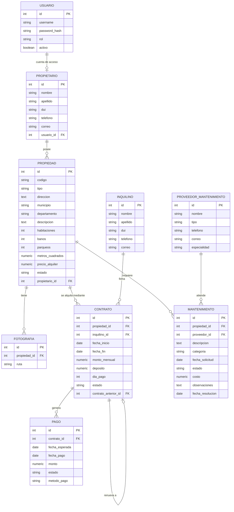

# 🏠 AdminHaus

**Aplicación web para la administración de propiedades residenciales en alquiler.**

<p align="center">
  
  
  
  
  
</p>

---

## 📖 Descripción

**AdminHaus** es un sistema web que centraliza la gestión de una cartera de propiedades en alquiler. Reúne en un solo lugar la información de **propietarios, inquilinos, propiedades, contratos, pagos, mantenimientos y proveedores**, que normalmente suele llevarse en hojas de cálculo, papeles o chats dispersos.

El sistema está pensado para tres tipos de usuarios, cada uno con su propio panel y sus propios permisos:

- **Administrador:** controla todo el sistema, incluida la gestión de cuentas de usuario.
- **Gestor:** opera el día a día (propiedades, contratos, pagos, mantenimientos, etc.) sin acceso a la administración de cuentas.
- **Propietario:** consulta, en modo lectura, la información de **sus propias** propiedades, contratos, pagos y mantenimientos.

El proyecto fue desarrollado como proyecto académico, siguiendo una arquitectura por capas (**Models → Services → Routes → Templates**) y una base de datos PostgreSQL con restricciones de integridad definidas a nivel de esquema.

### Características principales

- Acceso diferenciado por rol, validado en el **backend** (no solo ocultando botones).
- Panel de inicio (dashboard) distinto para cada rol.
- Ciclo completo de alquiler: propiedad → contrato → pagos → mantenimientos.
- Protección CSRF en todos los formularios y contraseñas almacenadas con hash.
- Búsqueda y filtros en los listados, resueltos en la capa de servicios.
- Interfaz basada en un diseño propio (Figma) con CSS global reutilizable.

## ✨ Funcionalidades

| Módulo | Descripción |
|---|---|
| **Inicio (Dashboard)** | Resumen según el rol: total de propiedades, porcentaje de propiedades alquiladas, pagos pendientes, mantenimientos abiertos, y listas de pagos y mantenimientos recientes. El propietario ve únicamente los datos de sus propiedades. |
| **Usuarios** | Crear, ver, editar y bloquear/desbloquear cuentas (Gestor o Propietario). Al crear un usuario Propietario se crea o vincula su registro de propietario en la misma transacción. Exclusivo del administrador. |
| **Propietarios** | Registrar y administrar los datos personales de los propietarios (nombre, DUI, teléfono, correo) junto con su cuenta de acceso. |
| **Inquilinos** | Registrar y consultar inquilinos con sus datos de contacto e identificación. |
| **Propiedades** | Registrar casas y apartamentos con código, ubicación, habitaciones, baños, parqueos, metros cuadrados, precio de alquiler, estado y propietario. Incluye galería de **fotografías mediante URL**. |
| **Contratos** | Asociar una propiedad con un inquilino definiendo fechas, monto mensual, depósito y día de pago. Permite encadenar un contrato con el anterior (renovaciones). |
| **Pagos** | Control de los pagos esperados de cada contrato. El sistema determina automáticamente si un pago está pendiente o vencido según la fecha, y exige fecha y método de pago para marcarlo como pagado. |
| **Mantenimientos** | Registrar solicitudes de mantenimiento por propiedad, con categoría, proveedor asignado, costo, estado y fechas de solicitud/resolución. |
| **Proveedores** | Directorio de técnicos y empresas de mantenimiento con su especialidad y contacto. |

### 🔐 Roles y permisos

| Módulo | Administrador | Gestor | Propietario |
|---|:---:|:---:|:---:|
| Usuarios | ✅ Completo | ❌ | ❌ |
| Propietarios | ✅ | ✅ | ❌ |
| Inquilinos | ✅ | ✅ | ❌ |
| Propiedades | ✅ Completo | ✅ Completo | 👁️ Solo las suyas |
| Contratos | ✅ Completo | ✅ Completo | 👁️ Consulta |
| Pagos | ✅ Completo | ✅ Completo | 👁️ Consulta |
| Mantenimientos | ✅ Completo | ✅ Completo | 👁️ Consulta |
| Proveedores | ✅ | ✅ | ❌ |

### 🛡️ Seguridad

- Cada ruta está protegida con los decoradores `login_required` / `roles_required` (`app/security.py`). Quien no ha iniciado sesión es redirigido al login; quien no tiene el rol adecuado recibe un error 403.
- Un **propietario** solo puede abrir propiedades que le pertenecen. La relación se resuelve en el servidor: `usuario → propietario → propiedad`, por lo que escribir la URL manualmente no da acceso a datos ajenos.
- Todas las peticiones `POST` exigen token CSRF (Flask-WTF).
- Las contraseñas se guardan con hash (Werkzeug); nunca en texto plano.
- Un administrador no puede bloquear su propia cuenta ni crear otros administradores desde el módulo de usuarios.
- El rol de una cuenta administradora no se puede modificar desde la interfaz.

## 📱 Capturas de pantalla

> Agrega tus capturas en `docs/screenshots/` y ajusta los nombres de archivo si es necesario.

| Login | Dashboard | Propiedades | Formulario de propiedad |
|---|---|---|---|
|  |  |  |  |

| Contratos | Pagos | Mantenimientos | Usuarios |
|---|---|---|---|
|  |  |  |  |

## 🛠️ Tecnologías utilizadas

| Tecnología | Uso |
|---|---|
| **Python** | Lenguaje principal del backend. |
| **Flask** | Framework web, rutas y blueprints. |
| **Flask-SQLAlchemy / SQLAlchemy 2.0** | ORM y acceso a la base de datos. |
| **PostgreSQL** | Motor de base de datos relacional. |
| **Psycopg 3** | Driver de conexión a PostgreSQL. |
| **Flask-WTF** | Protección CSRF. |
| **Werkzeug** | Hash de contraseñas. |
| **python-dotenv** | Carga de variables de entorno. |
| **Jinja2** | Motor de plantillas HTML. |
| **Bootstrap 5.3.3** | Componentes y sistema de rejilla. |
| **Bootstrap Icons** | Iconografía. |
| **HTML / CSS / JS** | Interfaz; CSS global propio (`global.css`) con la fuente Poppins. |
| **Git y GitHub** | Control de versiones. |

## 🏗️ Arquitectura y estructura del proyecto

AdminHaus usa una arquitectura por capas con **Blueprints** de Flask. Cada módulo sigue el mismo patrón para mantener el código ordenado y predecible.

### Flujo de una petición

```text
Navegador
    ↓
  Route        → recibe la petición y valida permisos
    ↓
 Service       → lógica de negocio, validaciones y consultas
    ↓
  Model        → entidades SQLAlchemy
    ↓
PostgreSQL
    ↓
 Template      → Jinja2 renderiza la respuesta
```

- **Models:** representan las tablas existentes de la base de datos.
- **Services:** concentran la lógica de negocio y las consultas (las rutas no contienen consultas complejas).
- **Routes:** reciben la petición, comprueban permisos, llaman al service y devuelven una respuesta (`render_template`, `redirect`, `flash`).
- **Templates:** plantillas organizadas por módulo y heredadas de una base según el rol.

### Estructura general

```text
AdminHaus/
│
├── app/
│   ├── __init__.py              # Application factory y registro de blueprints
│   ├── security.py              # login_required, roles_required, usuario_activo
│   │
│   ├── models/                  # usuario, propietario, inquilino, propiedad,
│   │                            # fotografia, contrato, pago,
│   │                            # proveedor_mantenimiento, mantenimiento
│   ├── routes/                  # auth, dashboard, usuarios, propietarios,
│   │                            # inquilinos, propiedades, contratos, pagos,
│   │                            # mantenimientos, proveedores
│   ├── services/                # Lógica de negocio de cada módulo
│   │
│   ├── templates/
│   │   ├── bases/               # base.html, base_admin / base_gestor / base_propietario
│   │   ├── usuarios/  propietarios/  inquilinos/  propiedades/
│   │   ├── contratos/  pagos/  proveedores/
│   │   └── dashboard_*.html, login.html, mantenimientos.html ...
│   │
│   └── static/css/global.css    # Sistema visual de AdminHaus
│
├── Base_de_Datos_AdminHaus.sql  # Esquema de la base de datos
├── crear_usuario.py             # Script para crear el administrador inicial
├── config.py
├── requirements.txt
└── run.py
```

## 🗄️ Modelo de base de datos

El esquema se define en `Base_de_Datos_AdminHaus.sql` e incluye restricciones `CHECK` (estados válidos, montos no negativos, coherencia de fechas) y llaves foráneas con reglas de borrado explícitas. La aplicación **no** crea las tablas por sí misma (no usa `db.create_all()`).



### Valores permitidos

| Campo | Valores |
|---|---|
| `usuario.rol` | `ADMINISTRADOR`, `GESTOR`, `PROPIETARIO` |
| `propiedad.tipo` | `CASA`, `APARTAMENTO` |
| `propiedad.estado` | `DISPONIBLE`, `ALQUILADA`, `INACTIVA` |
| `contrato.estado` | `ACTIVO`, `FINALIZADO`, `CANCELADO` |
| `pago.estado` | `PENDIENTE`, `PAGADO`, `VENCIDO` |
| `mantenimiento.estado` | `PENDIENTE`, `EN PROCESO`, `RESUELTO`, `CANCELADO` |
| `proveedor_mantenimiento.tipo` | `TECNICO`, `EMPRESA` |

### Reglas de negocio destacadas

- Un usuario con rol **Propietario** siempre tiene su registro de `propietario` asociado; ambos se crean dentro de la misma transacción (si algo falla se hace rollback).
- No se puede eliminar un propietario con propiedades (`ON DELETE RESTRICT`); al eliminar una propiedad se eliminan sus fotografías (`ON DELETE CASCADE`).
- Un pago `PAGADO` debe tener fecha y método de pago; los estados `PENDIENTE` y `VENCIDO` se calculan según la fecha esperada.
- La fecha de fin de un contrato no puede ser anterior a su fecha de inicio, y los montos no pueden ser negativos.
- Las fotografías de una propiedad se guardan como **URL externa**; la aplicación no almacena archivos.

## 🎨 Diseño de interfaz

La interfaz fue diseñada en **Figma** e implementada con Bootstrap 5.3.3 y un CSS global propio, con la tipografía **Poppins**.

| Variable | Color | Uso |
|---|---|---|
| `--primary` | `#0B2E59` | Acciones principales y menú lateral |
| `--primary-hover` | `#174A87` | Estado hover |
| `--background` | `#F5F7FA` | Fondo general |
| `--surface` | `#FFFFFF` | Tarjetas y tablas |
| `--text` / `--text-secondary` | `#2D3748` / `#718096` | Texto |
| `--success` / `--warning` / `--danger` / `--info` | `#38A169` / `#D69E2E` / `#E53E3E` / `#3182CE` | Estados y alertas |

Cada rol tiene su propia plantilla base (`base_admin`, `base_gestor`, `base_propietario`) con un menú lateral adaptado a sus permisos.

## 🚀 Instalación y ejecución

### Requisitos

- Python 3.10 o superior.
- PostgreSQL instalado y en ejecución.
- Git.

### 1. Clonar el repositorio

```bash
git clone https://github.com/USUARIO/REPOSITORIO.git
cd REPOSITORIO
```

### 2. Crear el entorno virtual e instalar dependencias

```bash
python -m venv venv

# Windows
venv\Scripts\activate
# macOS / Linux
source venv/bin/activate

pip install -r requirements.txt
```

### 3. Crear la base de datos

```bash
createdb -U postgres adminhaus
psql -U postgres -d adminhaus -f Base_de_Datos_AdminHaus.sql
```

### 4. Configurar las variables de entorno

Crea un archivo `.env` en la raíz del proyecto:

```env
SECRET_KEY=una_clave_secreta_larga_y_aleatoria
DB_USER=postgres
DB_PASSWORD=tu_contraseña
DB_HOST=localhost
DB_PORT=5432
DB_NAME=adminhaus
```

> ⚠️ El archivo `.env` está incluido en `.gitignore`. No lo subas al repositorio.

### 5. Crear el administrador inicial

```bash
python crear_usuario.py
```

El script solicita usuario y contraseña. Con esa cuenta podrás iniciar sesión y crear el resto de usuarios (gestores y propietarios) desde el módulo **Usuarios**.

### 6. Ejecutar la aplicación

```bash
python run.py
```

Abre <http://127.0.0.1:5000> en tu navegador.

## 🌿 Control de versiones

Durante el desarrollo se utilizó Git y GitHub para administrar el código fuente y facilitar el trabajo colaborativo.

## 👥 Equipo de desarrollo

| Integrante |
|---|
| _Douglas Leon_ |
| _Daniel Barrera_ |

**Información académica**

- **Asignatura:** _Nombre de la asignatura_
- **Carrera:** _Nombre de la carrera_
- **Universidad:** _Nombre de la universidad_
- **Docente:** _Nombre del docente_
- **Ciclo académico:** _Ciclo y año_

## 📄 Licencia

Proyecto académico desarrollado con fines educativos.
